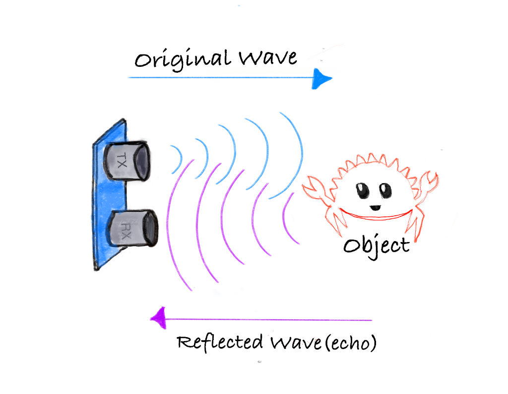
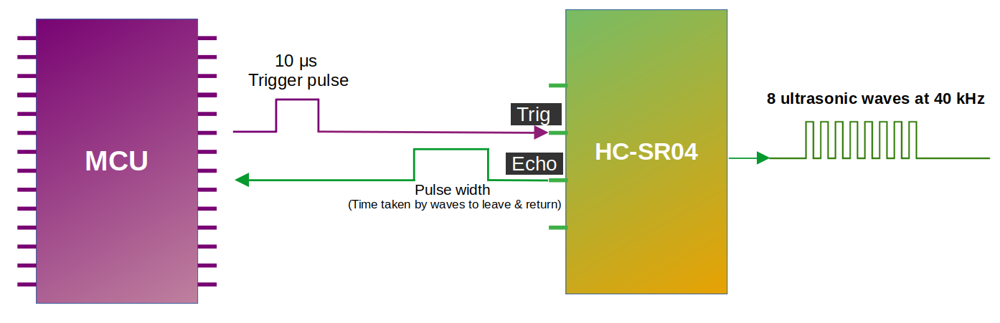

# Как работает ультразвуковой датчик?

Ультразвуковые датчики работают, испуская звуковые волны на частоте (40 кГц), которая слишком высока для человеческого уха. Эти звуковые волны распространяются в воздухе и отражаются, когда натыкаются на предмет. Датчик вычисляет расстояние, измеряя, сколько времени звуковым волнам нужно, чтобы вернуться.



- **Передатчик:** испускает ультразвуковые звуковые волны.
- **Приёмник:** обнаруживает звуковые волны, отражённые от предмета.

**Формула для вычисления расстояния**:

```text
Distance = (Time x Speed of Sound) / 2
```

Скорость звука при нормальном атмосферном давлении и температуре 20 °C составляет примерно 0,0343 см/мкс (или 343 м/с).

## Пример расчёта

Допустим, ультразвуковой датчик фиксирует, что звуковой волне понадобилось 2000 мкс, чтобы вернуться после удара о предмет.

Шаг 1: вычисляем общее расстояние, которое прошла звуковая волна:

```
Total distance = Time x Speed of Sound
Total distance = 2000 µs x 0.0343 cm/µs = 68.6 cm
```

Шаг 2: поскольку звуковая волна прошла до предмета и обратно, расстояние до предмета — половина общего пути:

```
Distance to object = 68.6 cm / 2 = 34.3 cm
```

Итак, предмет находится на расстоянии 34,3 см от датчика.

## Распиновка HC-SR04

У модуля четыре вывода: `VCC`, `Trig`, `Echo` и `GND`.

<table style="width:300px;height:200px;">
<tr>
    <th>Вывод</th>
    <th>Функция</th>
</tr>
<tr>
    <td style="vertical-align: middle;text-align: center;" class="slanted-text st-red">VCC</td>
    <td>Питание</td>
</tr>
<tr>
    <td style="vertical-align: middle;text-align: center;" class="slanted-text st-yellow">Trig</td>
    <td>Сигнал запуска (Trigger)</td>
</tr>
<tr>
    <td style="vertical-align: middle;text-align: center;" class="slanted-text st-teal">Echo</td>
    <td>Сигнал эха (Echo)</td>
</tr>
<tr>
    <td style="vertical-align: middle;text-align: center;" class="slanted-text st-blue">GND</td>
    <td>Земля</td>
</tr>
</table>

## Измерение расстояния с помощью модуля HC-SR04

В модуле HC-SR04 есть передатчик и приёмник, которые отвечают за отправку ультразвуковых волн и обнаружение отражённых. Мы будем использовать вывод `Trig`, чтобы посылать звуковые волны, и считывать сигнал с вывода `Echo`, чтобы измерять расстояние.



Как видно на схеме, мы подключаем выводы `Trig` и `Echo` к выводам GPIO микроконтроллера (также подключаем VCC и GND, но на схеме их опустили, чтобы не усложнять рисунок). Чтобы отправить ультразвуковые волны, мы переводим вывод `Trig` в HIGH на 10 микросекунд, а затем возвращаем его в LOW. Это заставляет модуль отправить 8 последовательных ультразвуковых волн на частоте 40 кГц. Рекомендуется делать паузу не менее 50 мс между запусками.

Когда волны датчика натыкаются на предмет, они отражаются обратно к модулю. Как видно на схеме, вывод `Echo` меняет сигнал, который передаётся микроконтроллеру: длительность, в течение которой сигнал остаётся в HIGH (ширина импульса), соответствует расстоянию. В микроконтроллере мы измеряем, сколько времени вывод `Echo` остаётся в HIGH. Затем эту длительность можно использовать для вычисления расстояния до предмета.

**Ширина импульса и расстояние:**

Ширина импульса (время, в течение которого сигнал остаётся в высоком состоянии), которую выдаёт вывод `Echo`, находится примерно в диапазоне от 150 мкс до 25 000 мкс (25 мс). Это только если сигнал отразился от предмета. Если предмета нет, ширина импульса составит около 38 мс.
