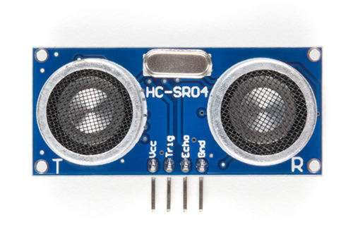

{{#title Ультразвуковой датчик расстояния с Raspberry Pi Pico 2 во встраиваемом Rust}}

# Маячок летучих мышей: проект датчика расстояния 🦇

Если вы смотрели фильм «Бэтмен: Начало», то помните сцену, где Бэтмен использует устройство, которое испускает ультразвуковые сигналы, чтобы призвать рой летучих мышей. Это один из самых крутых гаджетов в его арсенале! Хотя мы сегодня не будем строить маячок для призыва летучих мышей, мы будем работать с похожей ультразвуковой технологией.

## Ультразвук

Ультразвуковые волны — это звуковые волны с частотой выше 20 000 Гц, за пределами того, что способно услышать человеческое ухо, но многие животные их слышат. Летучие мыши используют ультразвук, чтобы летать в темноте и избегать препятствий. Дельфины применяют его для общения и для обнаружения предметов под водой.

### Ультразвуковые технологии вокруг нас

Люди позаимствовали этот природный принцип эхолокации для повседневных изобретений:

- **Датчики парковки** используют ультразвуковые датчики, чтобы обнаруживать препятствия при движении задним ходом. Чем ближе вы подъезжаете к предмету, тем чаще пищит сигнал.
- **Подводные лодки** используют сонар для навигации и обнаружения предметов под водой
- **Медицинское ультразвуковое исследование** позволяет врачам заглянуть внутрь человеческого тела
- **Автоматические двери и навигация роботов** опираются на ультразвуковое определение расстояния

Сегодня вы создадите собственный датчик расстояния на основе ультразвукового модуля: он будет посылать звуковые волны, измерять, сколько времени им нужно, чтобы вернуться, и вычислять расстояние.

## Знакомство с железом

HC-SR04+ — простой и недорогой ультразвуковой датчик расстояния. Он может измерять расстояния примерно от 2 см до 400 см. Он работает так: посылает короткий импульс ультразвука, а затем слушает эхо. Измеряя, сколько времени занимает возврат эха, датчик вычисляет, как далеко находится объект.

> [!TIP]
> HC-SR04 обычно работает от 5 В, что может быть проблемой для Raspberry Pi Pico. По возможности купите версию **HC-SR04+**, которая работает и от 3,3 В, и от 5 В, поэтому она больше подходит для Pico.
>
> **Почему это важно:**
> Вывод Echo у HC-SR04 выдаёт сигнал 5 В, а выводы GPIO Pico безопасно выдерживают только 3,3 В. Прямое подключение 5 В к Pico может его повредить.
>
> **Ваши варианты:**
>
> 1. **Купить вариант HC-SR04+** (рекомендуемое и самое простое решение)
> 2. **Использовать делитель напряжения** на выводе Echo, чтобы снизить сигнал 5 В до 3,3 В
> 3. **Использовать преобразователь логических уровней**, чтобы безопасно понизить напряжение
> 4. **Питать HC-SR04 от 3,3 В** (не рекомендуется: он может работать ненадёжно или не работать вообще)

В этом проекте мы создадим детектор приближения, который постепенно делает светодиод ярче по мере приближения предметов. Когда датчик обнаруживает что-то в пределах 30 см, светодиод будет светиться ярче с помощью ШИМ. Если хотите попробовать другие идеи, можно изменить значение расстояния.

## Предварительные требования

Перед началом познакомьтесь с этими темами:

- [ШИМ](../core-concepts/pwm/index.md)
- [Делитель напряжения](../core-concepts/voltage-divider.md)

## Требования к оборудованию

Чтобы выполнить этот проект, вам понадобится:

- Ультразвуковой датчик HC-SR04+ или HC-SR04
- Макетная плата
- Перемычки
- Внешний светодиод (можно также использовать встроенный светодиод, но тогда код придётся изменить соответственно)
- Если вы используете стандартный модуль HC-SR04, который работает от 5 В, понадобятся два резистора (1 кОм и 2 кОм или 2,2 кОм), чтобы собрать делитель напряжения.

Модуль датчика HC-SR04 содержит передатчик и приёмник. У модуля есть выводы Trigger и Echo, которые можно подключить к выводам GPIO Pico. Когда приёмник обнаруживает возвращающуюся звуковую волну, вывод Echo переходит в HIGH на время, равное времени, за которое волна вернулась к датчику.

## Даташит

Большинство электронных компонентов поставляется с даташитом. Это техническая документация, которая рассказывает всё, что нужно знать о работе компонента, его электрических характеристиках и правильном использовании.

Даташит на ультразвуковой датчик HC-SR04 можно найти здесь:
[https://cdn.sparkfun.com/datasheets/Sensors/Proximity/HCSR04.pdf](https://cdn.sparkfun.com/datasheets/Sensors/Proximity/HCSR04.pdf)

Даташиты поначалу могут выглядеть пугающе из-за технических характеристик и схем, но понимать в них всё необязательно.
