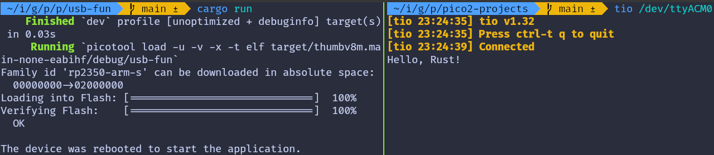

{{#title Связь по USB Serial с rp-hal на Raspberry Pi Pico 2}}

# Пример USB Serial с rp-hal

Мы возьмём [пример](https://github.com/rp-rs/rp-hal/blob/main/rp235x-hal-examples/src/bin/usb.rs) из репозитория RP HAL и немного изменим его, чтобы наглядно увидеть двустороннюю связь.

Исходный пример отправляет простое сообщение «Hello, World!» с Pico на компьютер, как только внутренний таймер достигает определённого значения. Также он опрашивает входящие данные с компьютера и отправляет данные обратно.

Мы немного усложним его и сделаем интереснее. Вместо «Hello, World!» мы отправим на компьютер «Hello, Rust!». Понимаю, это не самая интересная часть. Вот что будет интереснее: если вы введёте символ 'r' в терминале, подключённом по USB Serial, встроенный светодиод загорится. Введёте любой другой символ — светодиод погаснет.

## Проект из шаблона

Чтобы настроить проект, создайте его из предоставленного шаблона:

```sh
cargo generate --git https://github.com/ImplFerris/pico2-template.git --tag v0.3.2
```

Когда появится запрос, задайте проекту имя, например «usb-serial-led», и выберите `RP-HAL` в качестве HAL.

### Требуемые дополнительные крейты

Обновите Cargo.toml, добавив следующие крейты вместе с существующими зависимостями:

```rust
usbd-serial = "0.2.2"
usb-device = "0.3.2"
```

### Дополнительные импорты

```rust
// Поддержка USB Device
use usb_device::{class_prelude::*, prelude::*};

// Поддержка класса USB Communications Class Device
use usbd_serial::SerialPort;

// Для светодиода
use embedded_hal::digital::OutputPin;
```

## Настройка светодиода

Настроим встроенный светодиод.

```rust
let mut led = pins.gpio25.into_push_pull_output();
```

## Настройка драйвера USB

Сначала создаём шину USB, используя периферию USB RP2350 и её DPRAM:

```rust
let usb_bus = UsbBusAllocator::new(hal::usb::UsbBus::new(
    pac.USB,
    pac.USB_DPRAM,
    clocks.usb_clock,
    true,
    &mut pac.RESETS,
));
```

## Создание последовательного интерфейса CDC ACM

Далее создаём последовательный порт CDC ACM поверх шины USB:

```rust
let mut serial = SerialPort::new(&usb_bus);
```

Этот объект serial ведёт себя очень похоже на последовательный порт в стиле UART.

## Создание USB-устройства

Теперь описываем само USB-устройство, чтобы хост знал, как его перечислить:

```rust
let mut usb_dev = UsbDeviceBuilder::new(&usb_bus, UsbVidPid(0x16c0, 0x27dd))
    .strings(&[StringDescriptors::default()
        .manufacturer("implRust")
        .product("Ferris")
        .serial_number("TEST")])
    .unwrap()
    .device_class(2) // 2 для CDC, см.: https://www.usb.org/defined-class-codes
    .build();
```

Для разработки мы используем поддельные VID и PID, задаём базовые строковые дескрипторы и устанавливаем класс устройства CDC, чтобы Linux воспринимал его как последовательное устройство.

## Отслеживание приветственного сообщения

Объявляем флаг, который отслеживает, отправлено ли уже приветственное сообщение. Этот флаг проверяется внутри главного цикла, чтобы сообщение отправилось только один раз.

```rust
let mut said_hello = false;
```

## Главный цикл

### Отправка сообщения на компьютер

Как только программа начинает работать, мы проверяем таймер. Когда счётчик достигает 2 000 000 тактов, мы отправляем компьютеру сообщение «Hello, Rust!» и следим, чтобы оно было отправлено только один раз:

```rust
if !said_hello && timer.get_counter().ticks() >= 2_000_000 {
    said_hello = true;
    // Записывает байты из `data` в порт и возвращает количество записанных байтов.
    let _ = serial.write(b"Hello, Rust!\r\n");
}
```

### Опрос входящих данных

Одновременно мы непрерывно опрашиваем USB-устройство на предмет входящих данных. Когда данные приходят, мы считываем их и проверяем каждый полученный байт. Если символ — 'r', встроенный светодиод включается. Любой другой символ выключает светодиод:

```rust
if usb_dev.poll(&mut [&mut serial]) {
    let mut buf = [0u8; 64];
    if let Ok(count) = serial.read(&mut buf) {
        for &byte in &buf[..count] {
            if byte == b'r' {
                led.set_high().expect("unable to turn on LED");
            } else {
                led.set_low().expect("unable to turn off LED");
            }
        }
    }
}
```

## Полный код

```rust
#![no_std]
#![no_main]

use embedded_hal::delay::DelayNs;
use hal::block::ImageDef;
use rp235x_hal as hal;

//Обработчик паники
use panic_probe as _;

// Поддержка USB Device
use usb_device::{class_prelude::*, prelude::*};

// Поддержка класса USB Communications Class Device
use usbd_serial::SerialPort;

// Для светодиода
use embedded_hal::digital::OutputPin;

/// Сообщаем Boot ROM о нашем приложении
#[unsafe(link_section = ".start_block")]
#[used]
pub static IMAGE_DEF: ImageDef = hal::block::ImageDef::secure_exe();
/// Внешний высокоскоростной кварц на плате Raspberry Pi Pico 2 работает на 12 МГц.
/// Измените значение, если на вашей плате другая частота
const XTAL_FREQ_HZ: u32 = 12_000_000u32;

#[hal::entry]
fn main() -> ! {
    // Получаем наши синглтон-объекты
    let mut pac = hal::pac::Peripherals::take().unwrap();

    // Настраиваем драйвер сторожевого таймера — он нужен для настройки тактирования
    let mut watchdog = hal::Watchdog::new(pac.WATCHDOG);

    // Настраиваем тактирование
    //
    // По умолчанию генерируется системная частота 125 МГц
    let clocks = hal::clocks::init_clocks_and_plls(
        XTAL_FREQ_HZ,
        pac.XOSC,
        pac.CLOCKS,
        pac.PLL_SYS,
        pac.PLL_USB,
        &mut pac.RESETS,
        &mut watchdog,
    )
    .ok()
    .unwrap();

    // Блок SIO с однотактным доступом управляет нашими выводами GPIO
    let sio = hal::Sio::new(pac.SIO);

    // Настраиваем выводы в соответствии с их функциями на этой плате
    let pins = hal::gpio::Pins::new(
        pac.IO_BANK0,
        pac.PADS_BANK0,
        sio.gpio_bank0,
        &mut pac.RESETS,
    );

    let timer = hal::Timer::new_timer0(pac.TIMER0, &mut pac.RESETS, &clocks);

    let mut led = pins.gpio25.into_push_pull_output();

    let usb_bus = UsbBusAllocator::new(hal::usb::UsbBus::new(
        pac.USB,
        pac.USB_DPRAM,
        clocks.usb_clock,
        true,
        &mut pac.RESETS,
    ));

    let mut serial = SerialPort::new(&usb_bus);

    let mut usb_dev = UsbDeviceBuilder::new(&usb_bus, UsbVidPid(0x16c0, 0x27dd))
        .strings(&[StringDescriptors::default()
            .manufacturer("implRust")
            .product("Ferris")
            .serial_number("TEST")])
        .unwrap()
        .device_class(2) // 2 для CDC, см.: https://www.usb.org/defined-class-codes
        .build();

    let mut said_hello = false;

    loop {
        if !said_hello && timer.get_counter().ticks() >= 2_000_000 {
            said_hello = true;
            // Записывает байты из `data` в порт и возвращает количество записанных байтов.
            let _ = serial.write(b"Hello, Rust!\r\n");
        }

        if usb_dev.poll(&mut [&mut serial]) {
            let mut buf = [0u8; 64];
            if let Ok(count) = serial.read(&mut buf) {
                for &byte in &buf[..count] {
                    if byte == b'r' {
                        led.set_high().expect("unable to turn on LED");
                    } else {
                        led.set_low().expect("unable to turn off LED");
                    }
                }
            }
        }
    }
}

// Метаданные программы для `picotool info`.
// Это не обязательно, но рекомендуется добавить эти минимальные записи.
#[unsafe(link_section = ".bi_entries")]
#[used]
pub static PICOTOOL_ENTRIES: [hal::binary_info::EntryAddr; 5] = [
    hal::binary_info::rp_cargo_bin_name!(),
    hal::binary_info::rp_cargo_version!(),
    hal::binary_info::rp_program_description!(c"your program description"),
    hal::binary_info::rp_cargo_homepage_url!(),
    hal::binary_info::rp_program_build_attribute!(),
];

// Конец файла
```

## Клонируйте существующий проект

Можно клонировать проект, который я создал, и перейти в папку `usb-serial-led`.

```sh
git clone https://github.com/ImplFerris/pico2-rp-projects
cd pico2-rp-projects/usb-serial-led/
```

## Как запустить?

Прошивка (запуск кода) на Pico выполняется как обычно. Однако нужно настроить tio для взаимодействия с Pico через последовательный порт (`/dev/ttyACM0`). Это позволит читать данные с Pico или отправлять их на него.

### tio

Убедитесь, что в вашей системе установлен tio. Если нет, его можно установить командой:

```sh
apt install tio
```

### Подключение к последовательному порту

Выполните следующую команду, чтобы подключиться к последовательному порту Pico:

```sh
tio /dev/ttyACM0
```

Откроется сеанс терминала для связи с Pico.

### Прошивка и запуск кода

Откройте другой терминал, перейдите в папку проекта и прошейте код на Pico как обычно:

```sh
cargo run
```

Если всё настроено правильно, в терминале tio вы увидите сообщение «Connected», за которым последует сообщение «Hello, Rust!», отправленное с Pico.



### Отправка данных на Pico

В терминале, где запущен tio, всё, что вы печатаете, будет отправлено на Pico. Вы не увидите того, что печатаете (потому что мы не возвращаем введённые символы обратно в терминал).

Если вы нажмёте букву 'r', встроенный светодиод включится. Если нажмёте любой другой символ, светодиод выключится.

## Версия на Embassy

Также можно посмотреть этот проект, который демонстрирует использование USB Serial с фреймворком Embassy.

```sh
git clone https://github.com/ImplFerris/pico2-embassy-projects
cd pico2-embassy-projects/usb-serial/
```
