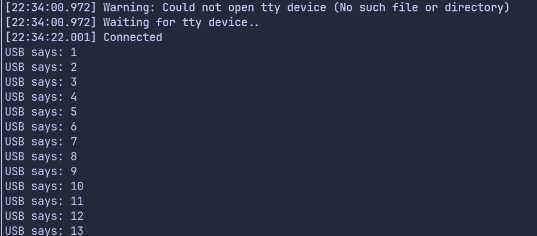

# Логирование по USB Serial с Embassy на Raspberry Pi Pico

В этой главе мы рассмотрим простой способ выводить сообщения с Raspberry Pi Pico в системную консоль через USB Serial. Мы будем использовать интерфейс USB вместе с крейтом `embassy-usb-logger`, чтобы отправлять логи на компьютер.

Пример намеренно будет небольшим. Pico ведёт счётчик, который увеличивается раз в секунду. Каждый раз, когда значение меняется, мы выводим его в системную консоль по USB. Когда счётчик достигает предела, он сбрасывается в ноль и продолжает работу. Цель здесь не сам счётчик, а демонстрация того, как работает логирование, когда в качестве вывода используется USB Serial.

Этот подход полезен, когда вы хотите, чтобы вывод логов появлялся на компьютере как обычное последовательное устройство. Настроив это один раз, вы сможете тем же способом выводить показания датчиков, изменения состояния или отладочные сообщения вашего приложения.

## Проект из шаблона

Начнём с создания нового проекта из шаблона.

```sh
cargo generate --git https://github.com/ImplFerris/pico2-template.git --tag v0.3.2
```

Когда появится запрос, задайте проекту имя, например «cdc-logger», и выберите embassy в качестве HAL. Включать `defmt` для этой схемы не нужно.

## Требуемые дополнительные крейты

Обновите `Cargo.toml`, добавив крейт логгера USB.

```toml
embassy-usb-logger = "0.5.1"
log = "0.4"
```

Крейт `embassy-usb-logger` предоставляет готовую реализацию логгера, который отправляет сообщения по USB. Крейт `log` предоставляет макросы логирования, которые используются во всей программе.

## Дополнительные импорты

Добавьте следующие импорты в файл `main.rs`.

```rust
// Для USB
use embassy_rp::{peripherals::USB, usb};
```

## Привязка прерывания USB

Периферии USB нужен обработчик прерываний. Embassy предоставляет этот обработчик, нам остаётся только привязать его.

```rust
embassy_rp::bind_interrupts!(struct Irqs {
    USBCTRL_IRQ => usb::InterruptHandler<USB>;
});
```

## Задача логгера USB

Работа с USB выполняется в собственной задаче. Эта задача создаёт драйвер USB и запускает логгер USB.

```rust
#[embassy_executor::task]
async fn logger_task(usb: embassy_rp::Peri<'static, embassy_rp::peripherals::USB>) {
    let driver = embassy_rp::usb::Driver::new(usb, Irqs);

    embassy_usb_logger::run!(1024, log::LevelFilter::Info, driver);
}
```

Задача логгера работает непрерывно и в фоне обрабатывает всю связь по USB.

## Функция main

В функции main мы запускаем задачу логгера USB.

```rust
spawner.must_spawn(logger_task(p.USB));
```

## Главный цикл

Мы ведём простой счётчик и увеличиваем его раз в секунду. Счётчик использует арифметику с переполнением (wrapping), поэтому после достижения максимального значения он возвращается к нулю. На каждой итерации мы логируем текущее значение с помощью `log::info!`, что отправляет сообщение по USB Serial.

```rust
let mut i: u8 = 0;
loop {
    i = i.wrapping_add(1);
    log::info!("USB says: {}", i);

    Timer::after_secs(1).await;
}
```

## Клонируйте существующий проект

Можно клонировать проект, который я создал, и перейти в папку `cdc-logger`.

```sh
git clone https://github.com/ImplFerris/pico2-embassy-projects
cd pico2-embassy-projects/usb-serial/cdc-logger/
```

## Как запустить?

Прошивка (запуск кода) на Pico выполняется как обычно. Однако нужно настроить `tio` для взаимодействия с Pico через последовательный порт (`/dev/ttyACM0`). Это позволит читать данные с Pico или отправлять их на него.

### tio

Убедитесь, что в вашей системе установлен `tio`. Если нет, его можно установить командой:

```sh
apt install tio
```

### Подключение к последовательному порту

Выполните следующую команду, чтобы подключиться к последовательному порту Pico:

```sh
tio /dev/ttyACM0
```

Откроется сеанс терминала для связи с Pico.

### Прошивка и запуск кода

Откройте другой терминал, перейдите в папку проекта и прошейте код на Pico как обычно:

```sh
cargo run --release
```

Когда программа начнёт работать, в терминале `tio` вы увидите значение счётчика, которое выводится раз в секунду.



### Ссылка

- [`rp-usb-console`](https://github.com/petersallai/rp-usb-console) — крейт для логирования по USB, который также поддерживает команды, например для настройки уровней логирования (на английском языке)
