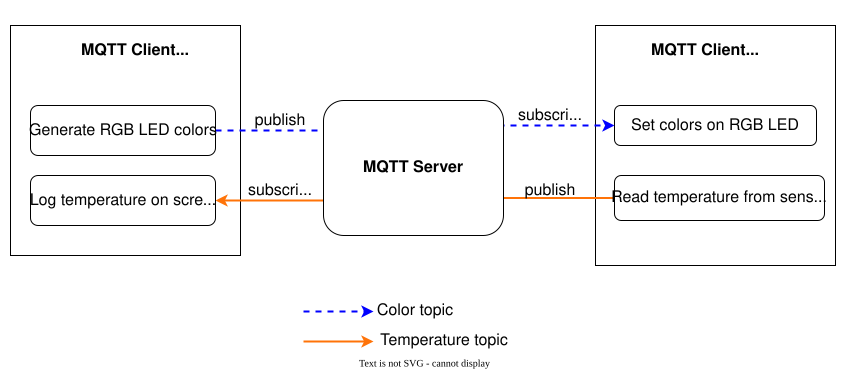

# Упражнение MQTT: отправка сообщений

## Подготовка

✅ Перейдите в папку `intro/mqtt/exercise`.

✅ Откройте подготовленную заготовку проекта в `intro/mqtt/exercise`.

✅ В `intro/mqtt/host_client` находится программа для запуска на компьютере, которая имитирует поведение второго клиента. Запустите её в отдельном терминале командой `cargo run`. Подробнее о клиенте-хосте — ниже.

Клиент также генерирует случайные RGB-цвета и публикует их в топике.
**Это важно только для второй части упражнения**.

⚠️ Как и в упражнениях с HTTP, нужно задать данные для подключения в `cfg.toml` **обеих программ**. Помимо данных Wi-Fi, нужно добавить параметры сервера MQTT. Нужные настройки смотрите в каждом `cfg.toml.example`. Напомним: имя в квадратных скобках в `cfg.toml` — это имя пакета из `Cargo.toml`.

Структура упражнения показана ниже. В этой части мы сосредоточимся на топике температуры.



`intro/mqtt/exercise/solution/solution_publ.rs` содержит решение. Запустить его можно командой:

```console
cargo run --example solution_publ
```

## Задания

✅ Создайте `EspMqttClient` с конфигурацией по умолчанию и пустым замыканием-обработчиком.

✅ Отправьте пустое сообщение в брокер в топик `hello_topic`. Для формирования правильного топика используйте служебную функцию `hello_topic(uuid)`.

✅ Проверьте, что публикация прошла успешно: подключите клиент, который логирует эти сообщения. Такое поведение реализовано в `host_client`. `host_client` должен работать в другом терминале до того, как вы запустите свою программу на ESP Rust Board. `host_client` должен вывести примерно следующее:
```console
Setting new color: rgb(1,196,156)
Setting new color: rgb(182,190,128)
Board says hi!
```

✅ В цикле в конце функции `main` публикуйте температуру платы в `temperature_data_topic(uuid)` каждую секунду. Проверьте это также с помощью `host_client`:
```console
Setting new color: rgb(218,157,124)
Board temperature: 33.29°C
Setting new color: rgb(45,88,22)
Board temperature: 33.32°C
```

## Установка соединения

Соединениями управляет экземпляр `esp_idf_svc::mqtt::client::EspMqttClient`.
Его создают, передавая:
- URL брокера, который при необходимости содержит учётные данные;
- конфигурацию типа `esp_idf_svc::mqtt::client::MqttClientConfiguration`;
- замыкание-обработчик, похожее на то, что используется в упражнении с HTTP-сервером.

```rust

let mut client = EspMqttClient::new(broker_url,
    &mqtt_config,
    move |message_event| {
        // ... ваш код обработчика — пока оставьте пустым
        // функциональность добавим позже в этой главе
    })?;

```

## Вспомогательные инструменты и крейты

Чтобы логировать показания датчиков, которые отправляет плата, в `intro/mqtt/host_client` есть вспомогательный клиент. Он подписан на топик температуры.

Крейт `mqtt_messages` (находится в `common/lib`) помогает работать с сообщениями, подписками и топиками:

### Функции для формирования строк топиков
-  `color_topic(uuid)` — создаёт топик, в который публикуются цвета для платы.
<!-- - `cmd_topic_fragment(uuid)` - creates the leading part of a "command" topic (the `a-uuid/command/` part in `a-uuid/command/board_led`) -->
- `hello_topic(uuid)` — тестовый топик для первоначальной проверки успешного подключения;
- `temperature_data_topic(uuid)` — создаёт полную строку топика «temperature».


### Кодирование и декодирование полезной нагрузки сообщений

Температура платы типа `f32` преобразуется в четыре байта в порядке «big-endian» с помощью `temp.to_be_bytes()`.

```rust
// температура
let temperature_data = &temp.to_be_bytes() as &[u8]; // плата
let decoded_temperature = f32::from_be_bytes(temperature_data); // компьютер разработчика
```

## Публикация и подписка

`EspMqttClient` также отвечает за публикацию сообщений в заданный топик.
Функция `publish` принимает параметр `retain`, который показывает, нужно ли доставлять это сообщение и клиентам, подключившимся после его публикации.

```rust
let publish_topic = /* ... */;
let payload: &[u8] = /* ... */ ;
client.publish(publish_topic, QoS::AtLeastOnce, false, payload)?;
```

## Устранение неполадок

- `error: expected expression, found .` при сборке примера клиента: обновите установленный stable Rust до версии 1.58 или новее.
- Не видно сообщений MQTT? Убедитесь, что все клиенты (плата и компьютер разработчика) используют один и тот же UUID (его видно в выводе логов).
- Убедитесь, что файл `cfg.toml` настроен правильно. В начале работы `example-client` выводит `dbg!()` с конфигурацией `mqtt`. Он должен вывести содержимое вашего `cfg.toml`.
- `error: expected expression, found .` при запуске host-клиента решается командой `rustup update`.
