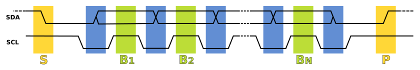

# I²C

## Введение

Inter-Integrated Circuit, обычно сокращаемый до I²C или I2C, — это последовательный протокол, который позволяет нескольким периферийным (или ведомым) микросхемам обмениваться данными с одной или несколькими управляющими (или ведущими) микросхемами. К одной шине I²C может быть подключено много устройств, а сообщение можно отправить конкретному устройству, указав его адрес I²C. Протоколу нужны две сигнальные линии, и он применяется только для связи на небольших расстояниях внутри одного устройства.

Одна линия — для данных (SDA), другая — для тактового сигнала (SCL). По умолчанию линии подтянуты к высокому уровню резисторами, установленными где-то на шине. Любое устройство на шине (или даже несколько устройств одновременно) может «притянуть» одну или обе линии к низкому уровню. Поэтому, если два устройства одновременно попытаются говорить по шине, ничего не сломается: сообщения просто искажаются, и это можно обнаружить.

I²C-_транзакция_ состоит из одного или нескольких _сообщений_. Каждое _сообщение_ состоит из _стартового символа_, нескольких _слов_ и, наконец, _стопового символа_ (или ещё одного _стартового символа_, если за ним следует другое сообщение). Каждое слово — это восемь бит, за которыми следует бит ACK (0) или NACK (1), который отправляет получатель, чтобы показать, было ли слово получено и понято правильно. Первое слово содержит 7-битный адрес устройства, которому адресовано сообщение, а также бит, показывающий, будет ли устройство _читаться_ или _записываться_. Если на шине нет устройства с таким адресом, за первым словом естественным образом последует NACK, потому что никакое устройство не притянет линию SDA к низкому уровню, чтобы сформировать бит ACK. Так вы поймёте, что устройства нет.

Тактовая частота линии SCL обычно составляет 400 кГц, но поддерживаются и более низкие, и более высокие скорости (стандартные скорости: 100 кГц, 400 кГц, 1 МГц). В нашем упражнении используется 400 кГц (` <MasterConfig as Default>::default().baudrate(400.kHz().into())`).

Чтобы прочитать три байта из EEPROM, последовательность будет примерно такой:

| Шаг  | Контроллер отправляет    | Периферия отправляет              |
| ---- | ------------------------ | --------------------------------- |
| 1.   | START                    |                                   |
| 2.   | Адрес устройства + W     |                                   |
| 3.   |                          | ACK                               |
| 4.   | Старший байт адреса EEPROM |                                 |
| 5.   |                          | ACK                               |
| 6.   | Младший байт адреса EEPROM |                                 |
| 7.   |                          | ACK                               |
| 8.   | START                    |                                   |
| 9.   | Адрес устройства + R     |                                   |
| 10.  |                          | ACK                               |
| 11.  |                          | Байт данных по адресу EEPROM      |
| 12.  | ACK                      |                                   |
| 13.  |                          | Байт данных по адресу EEPROM + 1  |
| 14.  | ACK                      |                                   |
| 15.  |                          | Байт данных по адресу EEPROM + 2  |
| 16.  | NAK (т. е. конец чтения) |                                   |
| 17.  | STOP                     |                                   |

### Изображение сигналов I²C

Диаграмма последовательности передачи данных по шине I²C:
- S — условие START;
- P — условие STOP;
- B1 ... BN — передача одного бита;
- изменения SDA допускаются, когда SCL низкий (синий), иначе будет сформировано условие START или STOP.

[Источник и подробности: Википедия](https://en.wikipedia.org/wiki/I%C2%B2C).
